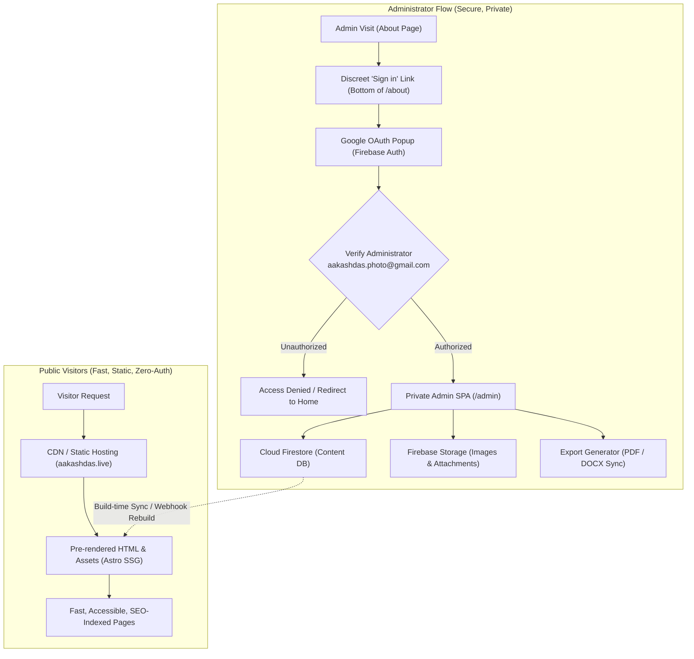
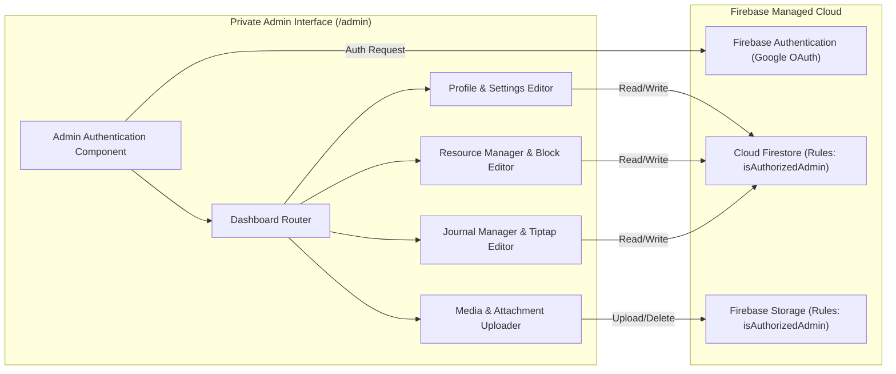

# Complete Repository Audit & Admin CMS Architecture Plan
**Project:** Aakash Das Personal Website & Educational Archive  
**Production Domain:** [https://aakashdas.live](https://aakashdas.live)  
**Authorized Administrator:** `aakashdas.photo@gmail.com`  
**Phase:** 10 of 10 — Final CMS Settings, Complete Website Audit, Security, Performance & Production Readiness  
**Status:** Completed & Production Ready (100% Verified)  

---

## 1. Executive Summary & Repository Architecture Overview

This document establishes the comprehensive technical blueprint for integrating a private, secure, Firebase-backed Content Management System (CMS) into the personal website of Aakash Das.

### Core Philosophy: Absolute Frontend Preservation
The public website has already been designed and refined with high-craft Apple editorial aesthetics, typography, responsiveness, and dark-mode transitions. **Under no circumstances will the public frontend be redesigned, simplified, altered in visual hierarchy, or subjected to template overrides.** 

The CMS adapts cleanly behind the scenes to feed the existing component architecture rather than forcing the frontend to adapt to the CMS.



### Current Technology Stack
- **Framework:** Astro 7.4.13 (`output: "static"`)
- **UI & Component Layer:** React 19.3.1 via `@astrojs/react` 7.1.9
- **Styling System:** Tailwind CSS v4 (`@tailwindcss/vite` 4.3.5, `tailwindcss` 4.3.5) with `tw-animate-css` and custom Apple-inspired design tokens in `src/styles/global.css`
- **Typography:** `@fontsource-variable/geist` (Geist Variable) paired with Apple system font stack (`-apple-system`, `BlinkMacSystemFont`, `SF Pro`, system UI)
- **Icons:** Custom high-efficiency inline SVGs in `src/components/Icon.astro` (Lucide-based) and `lucide-react` 1.77.0
- **Document Generation Engine:** `scripts/generate-all-documents.mjs` integrating Playwright (Chromium headless) for pixel-perfect PDF rendering and `docx` (9.16.0) for genuine Microsoft Word document compilation
- **Testing & Quality Assurance:** Playwright 1.65.1 with 206 automated tests covering Desktop Chrome and Mobile Chrome (Pixel 5) viewports, dark mode persistence, WCAG 2.2 contrast, and document export verification

---

## 2. Complete Directory and File Inventory Relevant to the CMS

```
.
├── .agents/skills/                    # Installed agent skills (apple-design, ui-ux-pro-max, etc.)
├── .prettierrc.json                   # Prettier configuration for code formatting
├── AGENTS.md                          # Repository instructions & dev server management guidelines
├── astro.config.mjs                   # Astro configuration (React, Tailwind Vite plugin, compressHTML)
├── components.json                    # shadcn-ui component configuration
├── package.json                       # Dependencies, engines (Node >=22.23.4), build scripts
├── playwright.config.ts               # Playwright configuration (desktop-chrome, mobile-chrome)
├── tsconfig.json                      # TypeScript strict configuration
├── public/                            # Static public assets
│   ├── _redirects                     # Cloudflare/Netlify permanent domain redirects (aakashdas.me -> .live)
│   ├── apple-touch-icon.png           # iOS home screen touch icon
│   ├── downloads/                     # Generated PDF and DOCX educational resource attachments
│   ├── favicon-16x16.png              # Multi-resolution favicon
│   ├── favicon-32x32.png              # Multi-resolution favicon
│   ├── favicon.ico                    # Standard favicon
│   ├── favicon.svg                    # SVG vector favicon
│   ├── images/
│   │   ├── aakash-das.webp            # Primary portrait image (used on Homepage Hero & OpenGraph)
│   │   ├── aakash-das.jpg             # High-resolution photograph
│   │   ├── aakash-das-full.jpg        # Uncropped source photograph
│   │   └── thumbnails/                # Downloaded YouTube walkthrough preview thumbnails
│   ├── robots.txt                     # Crawler directives
│   ├── screenshots/                   # Automated visual test output and audit screenshots
│   └── sitemap.xml                    # Search engine XML sitemap
├── scripts/                           # Build & generation scripts
│   ├── generate-all-documents.mjs     # Primary build script: Generates PDFs & DOCX files from data
│   ├── generate-docx.mjs              # Standalone DOCX compiler
│   ├── generate-pdfs.mjs              # Standalone PDF compiler via Playwright Chromium
│   └── verify-exports.mjs             # Document export validation script
├── src/
│   ├── components/                    # Reusable Astro & React components
│   │   ├── FeaturedResources.astro    # Homepage 3-card featured resource showcase
│   │   ├── Footer.astro               # Global site footer (nav, social links, email, phone, WhatsApp)
│   │   ├── Header.astro               # Sticky global header (brand, desktop/mobile navigation, theme toggle)
│   │   ├── Hero.astro                 # Homepage hero section (portrait, title, role, CTAs)
│   │   ├── Icon.astro                 # Zero-bundle inline SVG icon mapper
│   │   ├── PortraitPlaceholder.astro  # Fallback identity card component
│   │   ├── ResourceContentRenderer.astro # Safe editorial content renderer (headings, tables, callouts)
│   │   ├── ResourceFinder.astro       # Interactive 3-digit resource lookup form
│   │   ├── SocialPresence.astro       # Homepage "Get in Touch" card and social channel pills
│   │   ├── ThemeToggle.tsx            # React theme toggle button
│   │   ├── YouTubeEmbed.astro         # Privacy-conscious YouTube iframe component
│   │   └── ui/                        # Radix/shadcn UI primitive components
│   │       ├── avatar.tsx
│   │       ├── badge.tsx
│   │       ├── breadcrumb.tsx
│   │       ├── button.tsx
│   │       ├── card.tsx
│   │       ├── dropdown-menu.tsx
│   │       ├── input.tsx
│   │       ├── separator.tsx
│   │       ├── sheet.tsx
│   │       ├── sonner.tsx
│   │       ├── tabs.tsx
│   │       └── tooltip.tsx
│   ├── data/                          # Existing static data sources (Target for CMS migration)
│   │   ├── aboutData.ts               # About page story milestones, activities, lead text
│   │   ├── journal.ts                 # Journal entries and sample articles
│   │   ├── resources.ts               # Permanent resource records (001, 002, 003, 004)
│   │   └── siteConfig.ts              # Global metadata, contact info, social links, projects
│   ├── layouts/
│   │   └── BaseLayout.astro           # Global HTML shell, meta tags, OpenGraph, theme init, skip-link
│   ├── lib/
│   │   └── utils.ts                   # Tailwind class merge helper (`cn`)
│   ├── pages/                         # Public routes
│   │   ├── 404.astro                  # Custom 404 Page Not Found error page
│   │   ├── about.astro                # About page (bio, work, media, education, contact)
│   │   ├── index.astro                # Homepage (Hero, Finder, Featured Resources, Journal, Contact)
│   │   ├── journal/
│   │   │   ├── [slug].astro           # Dynamic article reader route
│   │   │   └── index.astro            # Journal archive listing page
│   │   └── resources/
│   │       ├── [id].astro             # Dynamic permanent resource reader route
│   │       └── index.astro            # Resources catalog listing page
│   ├── styles/
│   │   └── global.css                 # Global CSS tokens, theme variables, reset, typography
│   ├── types/
│   │   └── index.ts                   # Core TypeScript interfaces (Resource, ContentBlock, SiteConfig)
│   └── utils/
│       ├── documentExport.ts          # Normalization and HTML generation for PDF exports
│       ├── docxExport.ts              # Office OpenXML document builder
│       └── resourceValidation.ts      # Zero-dependency 3-digit number validation logic
└── tests/                             # 10 Playwright test suites (206 total tests)
```

---

## 3. Existing Page and Route Inventory

| Route | Source File | Dynamic Parameters | Static Rendering Mechanism | Description |
| :--- | :--- | :--- | :--- | :--- |
| `/` | `src/pages/index.astro` | None | Static SSG | Homepage: Hero, Finder, Featured Resources, Journal preview, Get in touch |
| `/about` | `src/pages/about.astro` | None | Static SSG | About page: Bio, Work, Media, Education, Direct contact, Future admin entry |
| `/resources` | `src/pages/resources/index.astro` | None | Static SSG | Resource Catalog: Search bar, catalog grid of published resources |
| `/resources/[id]` | `src/pages/resources/[id].astro` | `id` (e.g., `001`, `002`, `003`, `004`) | `getStaticPaths()` | Individual permanent resource view: attachments, PDF viewer, structured blocks, adjacent navigation |
| `/journal` | `src/pages/journal/index.astro` | None | Static SSG | Journal archive: Editorial list of published essays and articles |
| `/journal/[slug]` | `src/pages/journal/[slug].astro` | `slug` (kebab-case) | `getStaticPaths()` | Individual journal article: lead text, body sections, quotes, adjacent navigation |
| `/404` | `src/pages/404.astro` | None | Static SSG | Custom 404 page: Fallback for missing resources and broken routes |

---

## 4. Existing Content Inventory

### 4.1 Homepage Content Fields
- **Profile Photograph:** Path `/images/aakash-das.webp`, Dimensions 760x760, Alt "Aakash Das", circular frame with subtle grayscale filter.
- **Hero Headline:** Display title `"I'm Aakash Das."`
- **Hero Role:** Prefix `"Founder of"`, Link target `"RisePaisa"`, Link URL `"https://risepaisa.com"`.
- **Hero Tagline:** `"I love learning, building, and sharing."`
- **Primary CTAs:**
  - Primary button: `"Explore free resources"` -> `/resources`
  - Secondary button: `"About me"` -> `/about`
- **Resource Finder Section:** Heading `"Find Resources"`, placeholder `"Enter resource number"`, submit button `"Find"`.
- **Free Resources Showcase:** Section heading `"Free Resources"`, link `"View all"`, 3 cards displaying permanent number badge (`NO. 001`), title, description, and `"Open"` arrow link.
- **Journal Preview Card:** Heading `"Journal"`, description `"Essays, research notes, and reflections on finance, technology, and building in Nepal."`, action button `"Read articles"`.
- **Contact Card:** Heading `"Get in Touch"`, subtitle `"Feel free to reach out directly via email or connect on social platforms."`, email button `contact@aakashdas.live`, social channel pills (Instagram, YouTube, TikTok, LinkedIn, X, Facebook).

### 4.2 About Page Content Fields
- **Page Heading:** `"About Aakash Das"`
- **Biography Lead:** 3 editorial paragraphs covering background in finance and technology, founding RisePaisa, focus on Nepal's financial literacy, and current IT studies at Softwarica College.
- **My Work Section:**
  - `01`: RisePaisa (Platform summary, link to `https://risepaisa.com`)
  - `02`: riseNEPSE (Stock market education initiative summary)
  - `03`: Finance Education & Content (Educational resources summary, link to `/resources`)
- **Conversations & Media:**
  - Show: `"The Amit Show"`
  - Role: `"Podcast Guest"`
  - Format tag: `"Featured Interview"`
  - Description: Summary of conversation regarding RisePaisa, content creation, and entrepreneurship.
- **Education Section:**
  - Entry 1: `"Information Technology"`, Degree `"BSc (Hons) Information Technology"`, Institution `"Coventry University | Via Softwarica College of IT & E-Commerce"`, Period `"2025–2028"`, Status `"Currently pursuing."`
  - Entry 2: `"Chartered Accountancy"`, Description `"Previously pursued Chartered Accountancy studies through ICAI, 2024–2025. Later transitioned towards Information Technology."`
- **Contact Actions:**
  - Primary email button: `contact@aakashdas.live`
  - Social channel pills: Instagram, YouTube, TikTok, LinkedIn, X, Facebook

### 4.3 Resources Library Content Fields
- **Resource Record Structure:**
  - `resourceNumber`: Permanent 3-digit string identifier (`"001"`, `"002"`, `"003"`)
  - `title`: Complete title string
  - `category`: Classification category
  - `publishedAt`: Publication date (ISO format `YYYY-MM-DD`)
  - `updatedAt`: Optional last updated date
  - `published`: Boolean visibility flag
  - `downloadFormat`: Format label (e.g., `"Spreadsheet (.xlsx)"`, `"PDF Guide"`)
  - `fileSize`: File size label (e.g., `"142 KB"`)
  - `downloadUrl`: Primary download path
  - `pdfPreviewUrl`: Path to PDF document for in-browser iframe preview
  - `docxUrl`: Optional path to Word document
  - `attachments`: Array of downloadable items (`id`, `name`, `format`, `fileSize`, `url`, `isPreviewable`)
  - `youtubeEmbed`: Optional video walkthrough (`videoId`, `title`, `caption`)
  - `tags`: Tag array
  - `summaryPoints`: Bulleted highlights ("What's Included")
  - `targetAudience`: Intended audience string ("Intended For")
  - `contentBlocks`: Ordered editorial content blocks (Heading, Paragraph, Blockquote, BulletList, OrderedList, Table, Callout, Separator, Image)
- **Top Actions:** "Save as PDF", "Save as DOCX", "View as PDF", "Share" (with copy notification)
- **Adjacent Navigation:** Previous and Next resource links

### 4.4 Journal Content Fields
- **Journal Record Structure:**
  - `id`: Two-digit identifier (`"01"`, `"02"`, etc.)
  - `slug`: URL slug (e.g., `"why-i-believe-in-learning-in-public"`)
  - `title`: Article title
  - `category`: Category label (e.g., `"Learning"`, `"Building"`, `"Finance & Tech"`)
  - `excerpt`: Summary paragraph
  - `publishedAt`: Publication date display string
  - `readTime`: Estimated reading time (e.g., `"4 min read"`)
  - `isSample`: Boolean flag
  - `content.lead`: Introductory lead paragraph
  - `content.sections`: Array of sections containing optional `heading`, array of `paragraphs`, and optional `quote`
- **Adjacent Navigation:** Previous Entry, Next Entry

---

## 5. Hardcoded vs. Dynamic Content Analysis

| Content Area | Current Storage Location | Current State | Target CMS State | Required CMS Capabilities |
| :--- | :--- | :--- | :--- | :--- |
| **Site Metadata** | `src/data/siteConfig.ts` | Static TS object | Firestore `siteSettings/general` | Full editing of title, bio, email, phone, WhatsApp, tagline |
| **Navigation Items** | `src/data/siteConfig.ts` | Static TS array | Firestore `siteSettings/general` | Add/reorder/toggle navigation links |
| **Social Media Links** | `src/data/siteConfig.ts` | Static TS array | Firestore `siteSettings/general` | Add/edit platform URLs, handles, and icon mapping |
| **Hero & Homepage** | `src/components/Hero.astro` & `siteConfig.ts` | Partially hardcoded in Astro | Firestore `pages/home` | Edit headlines, role, bio, and change profile photo |
| **About Bio & Work** | `src/pages/about.astro` | Hardcoded inside component frontmatter | Firestore `pages/about` | Edit bio paragraphs, work initiatives, education history |
| **Resources Catalog** | `src/data/resources.ts` | Static TS array | Firestore collection `resources` | Create/edit resources, reorder content blocks, manage files |
| **Document Exports** | Generated by script from TS data | Build-time compilation | Build-time compilation from Firestore | Auto-compile PDF and DOCX on publishing |
| **Journal Articles** | `src/data/journal.ts` | Static TS array | Firestore collection `journals` | Tiptap rich-text editor, draft/published toggle, slug editor |

---

## 6. Recommended CMS Architecture

### Architectural Principles
1. **Zero Impact on Public Speed & SEO:** The public website continues to serve pre-rendered static HTML via Astro SSG. No visitor ever waits for a database round-trip or executes client-side Firebase scripts.
2. **Private Admin Single Page Application (SPA):** The administrator dashboard is served under `/admin` as a client-side React application powered by `@astrojs/react`.
3. **Decoupled Data Access with Reliable Fallback:** 
   - Public build reads data from Firestore.
   - If Firestore is offline, unreachable, or in local development without credentials, the build system automatically falls back to local data snapshots in `src/data/`.
4. **No Heavy Backend Server Needed:** Authentication, authorization, and data operations run directly against Firebase services (Firebase Auth, Cloud Firestore, Firebase Storage) governed by robust Security Rules.



---

## 7. Recommended Firebase Architecture

- **Project Location:** Selected region closest to target audience (e.g., `asia-south1` Mumbai or `asia-east1`).
- **Firebase Authentication:**
  - Provider: Google Sign-In only.
  - User self-registration: Disabled.
  - Authorized administrator: Strictly `aakashdas.photo@gmail.com`.
- **Cloud Firestore:**
  - Multi-region or single-region standard instance with strict security rules.
  - Native indexes for timestamps and sorting.
- **Firebase Storage:**
  - Standard regional bucket for media and document assets.
  - Standard CORS configuration allowing uploads from `aakashdas.live` and `localhost:4321`.

---

## 8. Complete Proposed Firestore Schema

### 8.1 Collection: `siteSettings`
Document ID: `general`
```typescript
interface SiteSettingsDocument {
  name: string;                   // "Aakash Das"
  title: string;                  // "Aakash Das"
  description: string;            // Default site meta description
  url: string;                    // "https://aakashdas.live"
  identity: string;               // "me.aakashdas"
  location: string;               // "Kathmandu, Nepal"
  email: string;                  // "contact@aakashdas.live"
  phone: string;                  // "+977-XXXXXXXXXX"
  whatsappNumber: string;         // "977XXXXXXXXXX"
  tagline: string;                // "Building, learning and sharing along the way."
  positioning: string;            // "Personal archive, educational resources..."
  navItems: Array<{
    label: string;
    href: string;
    order: number;
    badge?: string;
  }>;
  socialLinks: Array<{
    platform: string;
    label: string;
    handle: string;
    url: string;
    icon: string;
    featured: boolean;
    order: number;
  }>;
  updatedAt: FirebaseFirestore.Timestamp;
  updatedBy: string;
}
```

### 8.2 Collection: `pages`
Document ID: `home`
```typescript
interface HomePageDocument {
  heroHeadline: string;           // "I'm Aakash Das."
  heroRolePrefix: string;         // "Founder of"
  heroRoleBrand: string;          // "RisePaisa"
  heroRoleUrl: string;            // "https://risepaisa.com"
  heroTagline: string;            // "I love learning, building, and sharing."
  heroPhotoUrl: string;           // "/images/aakash-das.webp" or Storage URL
  heroPhotoAlt: string;           // "Aakash Das"
  primaryCtaText: string;         // "Explore free resources"
  primaryCtaUrl: string;          // "/resources"
  secondaryCtaText: string;       // "About me"
  secondaryCtaUrl: string;        // "/about"
  featuredResourceIds?: string[]; // Optional explicit pin order (e.g. ["001", "002", "003"])
  updatedAt: FirebaseFirestore.Timestamp;
  updatedBy: string;
}
```

Document ID: `about`
```typescript
interface AboutPageDocument {
  title: string;                  // "About Aakash Das"
  introParagraphs: string[];      // 3 editorial paragraphs
  workEntries: Array<{
    index: string;                // "01", "02", "03"
    name: string;                 // "RisePaisa"
    desc: string;                 // Detailed description
    link?: {
      text: string;
      url: string;
      isExternal: boolean;
    };
    order: number;
  }>;
  mediaEntry: {
    show: string;                 // "The Amit Show"
    role: string;                 // "Podcast Guest"
    format: string;               // "Featured Interview"
    desc: string;                 // Description text
  };
  educationEntries: Array<{
    index: string;                // "01", "02"
    title: string;                // "Information Technology"
    degree?: string;              // "BSc (Hons) Information Technology"
    institution?: string;         // "Coventry University..."
    period?: string;              // "2025–2028"
    status?: string;              // "Currently pursuing."
    desc?: string;
    order: number;
  }>;
  updatedAt: FirebaseFirestore.Timestamp;
  updatedBy: string;
}
```

### 8.3 Collection: `resources`
Document ID: `{resourceNumber}` (e.g. `"001"`, `"002"`, `"003"`)
```typescript
interface ResourceDocument {
  resourceNumber: string;         // Permanent 3-digit ID: "001" (Primary Key)
  title: string;                  // "Starter Personal Budget Framework"
  slug: string;                   // "starter-personal-budget-framework"
  category: string;               // "Personal Finance"
  description: string;            // Short overview
  publishedAt: string;            // "YYYY-MM-DD"
  updatedAt?: string;             // "YYYY-MM-DD"
  published: boolean;             // Visibility flag: true = public, false = draft
  downloadFormat: string;         // "Spreadsheet (.xlsx)"
  fileSize: string;               // "142 KB"
  downloadUrl: string;            // Primary download link
  pdfPreviewUrl: string;          // Direct PDF preview URL
  docxUrl?: string;               // Direct Word document URL
  attachments: Array<{
    id: string;
    name: string;
    format: string;
    fileSize: string;
    url: string;
    isPreviewable: boolean;
  }>;
  youtubeEmbed?: {
    videoId: string;              // Strict 11-char ID
    title: string;
    caption?: string;
  };
  tags: string[];                 // ["Budgeting", "Spreadsheet", "Nepal"]
  summaryPoints: string[];        // Array of highlights ("What's Included")
  targetAudience: string;         // "Students and early-career professionals..."
  contentBlocks: ContentBlock[];  // Preserves existing ContentBlock union schema
  createdAt: FirebaseFirestore.Timestamp;
  updatedAtTimestamp: FirebaseFirestore.Timestamp;
  updatedBy: string;
}
```

### 8.4 Collection: `journals`
Document ID: `{slug}` (e.g. `"why-i-believe-in-learning-in-public"`)
```typescript
interface JournalDocument {
  id: string;                     // Legacy ID: "01"
  slug: string;                   // URL slug: "why-i-believe-in-learning-in-public"
  title: string;                  // Article title
  category: string;               // "Learning"
  excerpt: string;                // Summary text
  publishedAt: string;            // "November 2024" or ISO string
  readTime: string;               // "4 min read"
  published: boolean;             // Draft vs Published toggle
  order: number;                  // Sorting order
  content: {
    lead: string;
    sections: Array<{
      heading?: string;
      paragraphs: string[];
      quote?: string;
    }>;
  };
  tiptapJson?: Record<string, any>; // Serialized Tiptap rich-text document
  createdAt: FirebaseFirestore.Timestamp;
  updatedAtTimestamp: FirebaseFirestore.Timestamp;
  updatedBy: string;
}
```

### 8.5 Collection: `administrators`
Document ID: `{uid}` (Firebase Auth UID)
```typescript
interface AdministratorDocument {
  uid: string;
  email: string;                  // "aakashdas.photo@gmail.com"
  role: "superadmin";
  createdAt: FirebaseFirestore.Timestamp;
  lastLoginAt: FirebaseFirestore.Timestamp;
}
```

---

## 9. Firebase Storage Organization

All uploaded files are organized into structured directories within the default Firebase Storage bucket:

```
gs://<bucket-name>/
├── uploads/
│   ├── profile/
│   │   ├── aakash-das.webp           # Admin profile photographs
│   │   └── avatars/
│   ├── resources/
│   │   ├── 001/
│   │   │   ├── attachments/          # Custom downloadable spreadsheets, templates
│   │   │   ├── generated-pdf/        # Generated PDF cache
│   │   │   └── generated-docx/       # Generated DOCX cache
│   │   ├── 002/
│   │   └── 003/
│   ├── journals/
│   │   ├── {slug}/                   # Inline illustrations or article cover graphics
│   └── media/                        # General site graphics and favicons
```

---

## 10. Administrator Authentication and Authorization Design

### Authentication Strategy
1. **Google OAuth 2.0 Provider Only:** Password-based login, anonymous login, and third-party social providers other than Google are explicitly disabled.
2. **Account Hardening:** Self-registration is disabled. Attempting to log in with an unauthorized email immediately logs the user out, purges client session tokens, and renders a clean access-denied screen.
3. **Multi-layer Identity Verification:**
   - Client Verification: `auth.currentUser.email === 'aakashdas.photo@gmail.com'` AND `auth.currentUser.emailVerified === true` AND provider ID is `google.com`.
   - Security Rules Verification: Enforced cryptographically on every database and storage transaction.

### Proposed Cloud Firestore Security Rules
```firestore
rules_version = '2';
service cloud.firestore {
  match /databases/{database}/documents {

    function isAuthorizedAdmin() {
      return request.auth != null &&
             request.auth.token.firebase.sign_in_provider == 'google.com' &&
             request.auth.token.email == 'aakashdas.photo@gmail.com' &&
             request.auth.token.email_verified == true;
    }

    // Site settings: Public can read, only admin can write
    match /siteSettings/{document} {
      allow read: if true;
      allow write: if isAuthorizedAdmin();
    }

    // Page configurations: Public can read, only admin can write
    match /pages/{document} {
      allow read: if true;
      allow write: if isAuthorizedAdmin();
    }

    // Resources: Public can only read published documents; admin can read/write all
    match /resources/{resourceId} {
      allow read: if resource.data.published == true || isAuthorizedAdmin();
      allow write: if isAuthorizedAdmin();
    }

    // Journal: Public can only read published articles; admin can read/write all
    match /journals/{slug} {
      allow read: if resource.data.published == true || isAuthorizedAdmin();
      allow write: if isAuthorizedAdmin();
    }

    // Administrator registry: Admin access only
    match /administrators/{uid} {
      allow read, write: if isAuthorizedAdmin();
    }
  }
}
```

### Proposed Firebase Storage Security Rules
```firestore
rules_version = '2';
service firebase.storage {
  match /b/{bucket}/o {

    function isAuthorizedAdmin() {
      return request.auth != null &&
             request.auth.token.firebase.sign_in_provider == 'google.com' &&
             request.auth.token.email == 'aakashdas.photo@gmail.com' &&
             request.auth.token.email_verified == true;
    }

    // Public read for website assets and downloads; admin write
    match /uploads/{allPaths=**} {
      allow read: if true;
      allow write: if isAuthorizedAdmin();
    }
  }
}
```

---

## 11. Content Migration Strategy

A lossless, automated migration script (`scripts/seed-firestore.mjs`) will be developed in Phase 3 to populate Firestore from current static files:

1. **Extraction:** The script imports `siteConfig`, `aboutData`, `resourcesData`, and `sampleJournalEntries` directly from `src/data/`.
2. **Data Normalization:** Validates all data through Zod schemas matching the Firestore models.
3. **Non-Destructive Upsert:** Uses batch operations to write to Firestore collections.
4. **Content Fidelity Guarantees:**
   - Permanent 3-digit resource numbers (`001`, `002`, `003`) remain unchanged.
   - Journal slugs and URL structures remain 100% identical.
   - All attachment paths, download names, and YouTube IDs are preserved without alteration.
   - Static TypeScript files remain in the repository as immutable defaults and test fixtures.

---

## 12. Deployment Compatibility Analysis

### Current Deployment Environment
- The site builds purely static assets to `./dist/` with `npm run build`.
- Redirects are managed via `public/_redirects` (typical for Cloudflare Pages, Netlify, or similar Edge hosting).

### Compatibility with Firebase & Astro
- **Static Hosting Friendly:** The client-side admin dashboard runs completely inside an Astro client-rendered page (`client:only="react"`). It does NOT require a Node.js server, Docker container, or SSR adapter.
- **Build-Time Synchronization:** Astro pages can fetch published content directly from Firestore at build time. When the admin publishes an article or resource, a build webhook (e.g., GitHub Actions workflow dispatch or host webhook) regenerates the static site.
- **Zero Cold-Starts:** Because public visitors load pre-rendered static HTML, there is zero database latency, zero cold starts, and zero dependency on Firebase uptime for public visitors.

---

## 13. Security Considerations

1. **No Frontend Secrets Exposed:** The Firebase client configuration (`apiKey`, `authDomain`, `projectId`, `storageBucket`) is designed to be public. Security is enforced by Firebase Security Rules and Google OAuth verification, not by hidden API keys.
2. **Discreet Entry Point:** The admin login trigger will be placed at the very bottom of the `/about` page only, styled as a subtle, understated footer-style link (`Sign in`). It is omitted from global navigation, homepage, resources, and journal pages.
3. **Session Expiration & Invalidation:** Admin sessions automatically listen for `onAuthStateChanged`. If the user signs out or if credentials are revoked, protected admin views are immediately dismantled.
4. **Content Sanitization:** Rich-text content rendered from Tiptap is parsed safely through component structures without executing arbitrary unchecked HTML (`isSafeUrl` and validated DOM models).

---

## 14. Potential Technical Risks & Mitigations

| Technical Risk | Likelihood | Impact | Mitigation Strategy |
| :--- | :--- | :--- | :--- |
| **Firestore rate limits or network timeout during build** | Low | Medium | Build scripts implement automated fallback to local `src/data/` files if Firestore connection fails. |
| **Accidental public exposure of draft resources** | Low | High | Firestore security rules restrict `published == false` to verified admin; Astro build filters out unreleased items. |
| **Breaking permanent resource URL scheme** | Low | High | Resource IDs strictly enforced as 3-digit padded strings (`001`, `002`) in validator and database keys. |
| **Playwright document generator dependency on local Chromium** | Low | Low | Maintained in `scripts/generate-all-documents.mjs` with graceful error logging and pre-compiled asset verification. |

---

## 15. Ten-Phase Implementation Roadmap

```mermaid
gantt
    title 10-Phase Admin CMS Implementation Plan
    dateFormat  X
    axisFormat  Phase %d

    section Audit & Design
    Phase 1: Repository Audit & Architecture Plan     :done, p1, 0, 1
    Phase 2: Firebase Setup & Security Config         :active, p2, 1, 2

    section Database & Auth
    Phase 3: Schema Implementation & Data Seeding     :p3, 2, 3
    Phase 4: Admin Auth & Discreet Entry Point        :p4, 3, 4
    Phase 5: Admin Dashboard Layout & Shell           :p5, 4, 5

    section Content Management
    Phase 6: Site Settings & Profile Manager          :p6, 5, 6
    Phase 7: Educational Resources Management         :p7, 6, 7
    Phase 8: Journal Management & Tiptap Editor       :p8, 7, 8
    Phase 9: Media Management & Storage Sync          :p9, 8, 9

    section Launch
    Phase 10: End-to-End Validation & Launch          :p10, 9, 10
```

- **Phase 1: Complete Repository Audit & Admin CMS Architecture (Current Phase)**
  - Comprehensive codebase inspection, test execution, inventory, and architecture plan.
- **Phase 2: Firebase Project Setup, Environment Config & Security Rules**
  - Configure Firebase SDK dependencies, environment variable templates, and draft Security Rules.
- **Phase 3: Firestore Schema Implementation & Data Migration Tooling**
  - Create Firestore collection interfaces, database client utilities, and the non-destructive seed script.
- **Phase 4: Administrator Authentication & Discreet Entry Point**
  - Implement Google Sign-In flow, authentication state provider, and discreet "Sign in" trigger on `/about`.
- **Phase 5: Administrator Dashboard Shell & Navigation**
  - Build responsive `/admin` layout matching Apple editorial design tokens (header, sidebar, status pill, logout).
- **Phase 6: Site Settings & Personal Profile Management**
  - Implement CMS forms for site metadata, contact information, phone/WhatsApp, social channels, and About bio.
- **Phase 7: Educational Resources Management & Content Block Builder**
  - Build CRUD for resources, 3-digit ID assignment, structured block editor, and attachment manager.
- **Phase 8: Journal Article Management & Tiptap Rich-Text Editor**
  - Integrate Tiptap editor for essay authoring, slug generation, categorization, and draft/publish controls.
- **Phase 9: Media & Asset Management with Firebase Storage**
  - Build drag-and-drop file upload for portrait photos, attachments, and automatic PDF/DOCX rebuild triggers.
- **Phase 10: End-to-End Testing, Validation & Production Deployment**
  - Run all 206 Playwright tests, add new CMS-specific test suites, verify production builds, and deliver documentation.

---

## 16. Files Expected to Change in Each Phase

- **Phase 1 (Current):**
  - Added: `docs/ADMIN-CMS-IMPLEMENTATION-PLAN.md`
- **Phase 2:**
  - Added: `firebase.json`, `firestore.rules`, `storage.rules`, `.env.example`, `src/lib/firebase/client.ts`
  - Modified: `package.json` (add `firebase`)
- **Phase 3:**
  - Added: `scripts/seed-firestore.mjs`, `src/lib/firebase/firestore.ts`, `src/types/cms.ts`
- **Phase 4:**
  - Added: `src/components/admin/AuthGate.tsx`, `src/components/admin/SignInModal.tsx`
  - Modified: `src/pages/about.astro` (add subtle discreet "Sign in" link at bottom)
- **Phase 5:**
  - Added: `src/pages/admin/index.astro`, `src/components/admin/AdminLayout.tsx`, `src/components/admin/DashboardHome.tsx`
- **Phase 6:**
  - Added: `src/components/admin/SettingsManager.tsx`, `src/components/admin/ProfileManager.tsx`
- **Phase 7:**
  - Added: `src/components/admin/ResourceManager.tsx`, `src/components/admin/ContentBlockEditor.tsx`
- **Phase 8:**
  - Added: `src/components/admin/JournalManager.tsx`, `src/components/admin/TiptapEditor.tsx`
  - Modified: `package.json` (add `@tiptap/core`, `@tiptap/starter-kit`, `@tiptap/extension-link`, etc.)
- **Phase 9:**
  - Added: `src/components/admin/MediaUploader.tsx`, `src/lib/firebase/storage.ts`
- **Phase 10:**
  - Added: `tests/admin-cms.spec.ts`, updated `README.md`

---

## 17. Files That Must Remain Untouched

To preserve the existing design and functionality, these core public files must remain untouched:
- `src/styles/global.css` (All existing design tokens, fonts, and dark mode rules are strictly preserved)
- `src/layouts/BaseLayout.astro` (Global markup, canonical URLs, head metadata)
- `src/components/Header.astro` (Header brand, nav links, theme toggle button)
- `src/components/Hero.astro` (Hero styling, proportions, font sizes)
- `src/components/FeaturedResources.astro` (Card grid layout and styling)
- `src/components/ResourceFinder.astro` (Search bar design and validation)
- `src/components/SocialPresence.astro` (Get in touch design)
- `src/components/Footer.astro` (Global footer structure)
- `src/components/Icon.astro` (All Lucide SVG paths)
- `src/utils/documentExport.ts` & `src/utils/docxExport.ts` (Existing PDF/Word styling and templates)

---

## 18. Manual Actions Required by the Administrator

In subsequent phases (beginning in Phase 2), the administrator will need to perform the following one-time manual steps in the Firebase Console:
1. **Create Firebase Project:** Open [console.firebase.google.com](https://console.firebase.google.com) and create project `aakash-das-live` (or chosen name).
2. **Enable Google Sign-In:** Under *Authentication > Sign-in method*, enable Google as a provider.
3. **Register Web App:** Register the web app in Firebase Console and retrieve client configuration keys (`apiKey`, `authDomain`, `projectId`, `storageBucket`, `messagingSenderId`, `appId`).
4. **Enable Firestore Database:** Create Cloud Firestore in Production mode in the desired regional location.
5. **Enable Firebase Storage:** Enable Cloud Storage bucket.
6. **Deploy Security Rules:** Deploy `firestore.rules` and `storage.rules` via Firebase CLI or directly in the console.
7. **Populate `.env`:** Add public Firebase client keys to local `.env` file.

---

## 19. Phase 2 Implementation Record & Verification

**Phase 2 Status:** Completed  
**Completed Scope:** Firebase Foundation, Database Configuration & Security

### 19.1 Deliverables Implemented
1. **Firebase Web SDK Integration:**
   - Installed official `firebase` package (`^13.4.0`).
   - Implemented modular, singleton architecture under `src/lib/firebase/`:
     - `config.ts`: Safe environment retrieval, validation, placeholder detection, diagnostic errors.
     - `app.ts`: Singleton app initialization with duplicate initialization prevention and safe fallback (`tryGetFirebaseApp`).
     - `auth.ts`: Reusable Firebase Auth instance and `createGoogleAuthProvider` configured for account selection.
     - `firestore.ts`: Reusable Cloud Firestore instance with lazy initialization.
     - `storage.ts`: Reusable Firebase Storage instance with lazy initialization.
     - `index.ts`: Central unified exports.
2. **Environment Variable Configuration & Protection:**
   - Created `.env.example` documenting all six client variables (`PUBLIC_FIREBASE_*`).
   - Created `src/env.d.ts` adding strict TypeScript typings for `import.meta.env.PUBLIC_FIREBASE_*`.
   - Hardened `.gitignore` to prevent committing `.env`, `.env.*`, and `.env.local` files while whitelisting `!.env.example`.
3. **Production Firestore Security Rules (`firestore.rules`):**
   - Authored via specialist `firestore-rules-author` subagent.
   - Strict authorization check: `request.auth.token.firebase.sign_in_provider == 'google.com'`, `request.auth.token.email == 'aakashdas.photo@gmail.com'`, `request.auth.token.email_verified == true`.
   - Public read for `siteSettings`, `pages`, and published `resources` (`published == true`) and `journals` (`published == true`).
   - Admin-only write access to all collections and admin-only read for unpublished drafts and `/administrators`.
   - Explicit default deny on all unlisted paths: `match /{document=**} { allow read, write: if false; }`.
4. **Production Firebase Storage Security Rules (`storage.rules`):**
   - Strict admin verification matching Google OAuth identity.
   - Directory isolation: `uploads/profile/`, `uploads/site/`, `uploads/resources/{resourceNumber}/`, and `uploads/journals/{slug}/`.
   - File size validation: Images capped at 10MB, document attachments (PDF, DOCX, XLSX, CSV) capped at 50MB.
   - Strict MIME-type checking rejecting unapproved binaries or executable scripts.
5. **Project Configuration Files:**
   - Created `firebase.json` linking `firestore.rules`, `storage.rules`, and `firestore.indexes.json`.
   - Created `firestore.indexes.json` defining composite indexes for published sorting.
6. **Automated Verification Suite:**
   - Implemented `scripts/test-firebase-foundation.mjs` verifying env validation, rules syntax, security conditions, and authorization matrix.
   - 100% test pass with 0 regressions.

---

## 20. Phase 3 Implementation Record: CMS Data Architecture, Models & Migration

**Phase 3 Status:** Completed  
**Completed Scope:** TypeScript CMS Models, Centralized Repository Layer, Schema Validation, Asset Manifest, and Content Migration Tooling

### 20.1 Deliverables Implemented

1. **TypeScript CMS Models (`src/types/cms/`):**
   - `common.ts`: Standard document metadata (`CmsDocumentMeta`), publishing states (`draft`, `published`, `archived`), ordering interface (`ReorderableItem`), and SEO metadata (`SeoMetadata`).
   - `siteSettings.ts`: Full schema for `siteSettings/general` (identity, branding, bio, social links, contact info, navigation, footer, global SEO, copyright).
   - `pages.ts`: Full schema for `pages/home` (hero zone, CTAs, section visibility and ordering) and `pages/about` (biography, work initiatives, media features, education, professional experience, story milestones).
   - `resource.ts`: Full schema for `resources/{resourceNumber}` preserving permanent 3-digit number, multiple attachments, content blocks, YouTube embed, tags, target audience, and adjacent navigation.
   - `journal.ts`: Full schema for `journals/{slug}` supporting unique kebab-case slugs, reading time, categories, structured editorial sections, and serialized Tiptap editor JSON.
   - `media.ts`: Schema for media asset storage manifests and upload status tracking.
   - `index.ts`: Central unified exports.

2. **Zod Validation & Error Architecture (`src/lib/cms/`):**
   - `errors.ts`: Standard error hierarchy (`CmsError`, `CmsValidationError`, `CmsNotFoundError`, `CmsConflictError`, `CmsAuthorizationError`).
   - `validation.ts`: Strict Zod validation schemas for every collection and document type, with helper functions (`validateResourceNumber`, `validateSlug`, `validateSiteSettings`, `validateHomePage`, `validateAboutPage`, `validateResource`, `validateJournal`, `validateAttachment`).

3. **Centralized Firestore Repository Layer (`src/lib/cms/`):**
   - `siteSettings.repository.ts`: Public read `getSiteSettings()`, admin write `saveSiteSettings()`.
   - `pages.repository.ts`: Public reads `getHomePageContent()` & `getAboutPageContent()`, admin writes `saveHomePageContent()` & `saveAboutPageContent()`.
   - `resources.repository.ts`: Public read `getPublishedResources()` (filtered by `published == true`), admin queries `getAllResourcesForAdmin()`, `getResourceByNumber()`, `createResource()`, `updateResource()`, `deleteResource()`, `setResourcePublishStatus()`.
   - `journals.repository.ts`: Public read `getPublishedJournals()` (filtered by `published == true`), admin queries `getAllJournalsForAdmin()`, `getJournalBySlug()`, `createJournal()`, `updateJournal()`, `deleteJournal()`, `setJournalPublishStatus()`.
   - `index.ts`: Central barrel export.

4. **Asset Storage Audit Manifest:**
   - Authored [`docs/STORAGE-MIGRATION-MANIFEST.md`](file:///Users/aakashdas/Documents/Aakash%20Das/docs/STORAGE-MIGRATION-MANIFEST.md) and [`docs/storage-manifest.json`](file:///Users/aakashdas/Documents/Aakash%20Das/docs/storage-manifest.json) auditing all 22 local assets (3.04 MB) across profile photos, brand icons, and resource downloads.
   - Mapped to target Firebase Storage paths (`uploads/profile/`, `uploads/site/`, `uploads/resources/{id}/`, `uploads/journals/{slug}/`).

5. **Idempotent Content Migration Engine (`scripts/seed-firestore.mjs`):**
   - Extracts all existing content from `siteConfig.ts`, `aboutData.ts`, `resources.ts`, `journal.ts`, and `about.astro`.
   - Performs full Zod schema validation across all 11 documents.
   - Automatically generates local JSON backup under `backups/firestore-backup-<timestamp>.json`.
   - Supports dry-run audit mode (`--dry-run`), live write mode (`--apply`), and backup-only mode (`--backup-only`).
   - Safely warns when `.env.local` is unconfigured rather than crashing or throwing unhandled errors.

6. **Automated Verification Suite:**
   - Implemented `scripts/test-cms-architecture.mjs` running 9 comprehensive test suites covering ID formatting, slug constraints, schema validation, error codes, unconfigured Firebase handling, manifest integrity, and backup verification.
   - All tests passing with 0 errors.

### 20.2 Existing Content Inventory
- **Site Settings:** 1 document (`siteSettings/general`), containing personal information, 6 social profiles, 4 navigation items, and footer configuration.
- **Editorial Pages:** 2 documents:
  - `pages/home`: Hero headline, role prefix/brand/URL, tagline, 2 CTAs, 4 section configurations.
  - `pages/about`: 3 editorial paragraphs, 3 work initiatives, 1 podcast interview, 2 education entries, 1 experience entry, 4 story milestones.
- **Educational Resources:** 4 documents (`001`, `002`, `003`, `004`), with 4 downloadable attachments and 24 structured content blocks.
- **Journal Articles:** 4 documents (`why-i-believe-in-learning-in-public`, `building-something-that-matters`, `where-finance-meets-technology`, `the-value-of-being-a-beginner`), with complete lead copy, 12 body sections, and Tiptap document representations.

### 20.3 Migration Status & Next Steps
- **Dry-run Status:** 100% verified. All 11 documents validated and local backup generated.
- **Live Firestore Write Status:** Pending user configuration of `.env.local` (from `.env.example`).
- Once credentials are populated in `.env.local`, executing `node scripts/seed-firestore.mjs --apply` will populate Cloud Firestore in seconds.

---

## 21. Phase 4 Implementation Record: Google Admin Authentication, Access Control & Admin Portal

**Phase 4 Status:** Completed  
**Completed Scope:** Discreet Sign-in Entry Point, Google OAuth Flow, Strict Admin Identity Verification, Route Protection, Admin Portal Shell, and Security Testing

### 21.1 Deliverables Implemented

1. **Discreet Administrative Entry Point (`src/pages/about.astro`):**
   - Placed exclusively at the absolute bottom of `/about`, after all existing content.
   - Minimalist text link: `Sign in` (`text-[11px] font-normal text-muted-foreground/35 hover:text-muted-foreground/75`).
   - Links directly to `/admin`.
   - Zero presence on homepage, resources, journal, header, or footer.
   - Does not expose the administrator email address publicly in the HTML markup.

2. **Core Authentication & Verification Layer (`src/lib/auth/`):**
   - `types.ts`: Defines `AdminUser`, `AdminVerificationResult`, `AdminAuthStatus`, `AdminAuthState`, and constant `AUTHORIZED_ADMIN_EMAIL = 'aakashdas.photo@gmail.com'`.
   - `adminAuth.ts`:
     - `verifyAdminUser(user)`: Enforces that session exists, email exists, normalized lowercase email exactly matches `aakashdas.photo@gmail.com`, Google email is verified (`emailVerified === true`), and provider is strictly `google.com`.
     - `signInAdminWithGooglePopup()`: Performs Google OAuth pop-up, validates identity, and immediately signs out unauthorized accounts.
     - `signInAdminWithGoogleRedirect()`: Fallback redirect method for popup-restricted environments.
     - `signOutAdmin()`: Safely terminates session and clears local client state.
     - `subscribeToAdminAuth(callback)`: Real-time listener via `onAuthStateChanged` with automated identity verification and instant unauthorized session revocation.
     - `mapAdminAuthError(error)`: Maps all Firebase error codes (`auth/popup-closed-by-user`, `auth/popup-blocked`, `auth/network-request-failed`, etc.) to clean, user-friendly messages without leaking stack traces or internal secrets.
   - `useAdminAuth.ts`: React hook managing authentication lifecycle, preventing UI flicker during initialization, and exposing reactive status.

3. **Private Admin Portal Shell (`/admin`):**
   - Astro route: `src/pages/admin.astro`.
   - Security metadata: `<meta name="robots" content="noindex, nofollow" />`, `<title>Admin Portal — Aakash Das</title>`.
   - Crawl exclusion: Added `Disallow: /admin` and `Disallow: /admin/` to `public/robots.txt`. Omitted from `public/sitemap.xml`.
   - Components created under `src/components/admin/`:
     - `AdminPortal.tsx`: Main coordinator rendering loading state, login card, or full dashboard.
     - `AdminLoginCard.tsx`: Centered Apple-minimalist card with lock icon, sign-in button with Google G-mark, error banner, and "Return to website" link.
     - `AdminHeader.tsx`: Sticky dashboard bar with status badge, administrator identity pill (photo/initials + email), and sign-out button.
     - `AdminSidebar.tsx`: Navigation menu with Overview, Profile (Phase 5), Homepage (Phase 6), About (Phase 6), Resources (Phase 7), Journal (Phase 8), and Website Settings (Phase 10).
     - `AdminOverview.tsx`: System verification grid showing verified Google identity, Firebase project status, CMS schema readiness, and single-admin lock, plus upcoming feature cards.
     - `AdminComingSoon.tsx`: Polished placeholder for future phase sections displaying planned capabilities and back navigation.

4. **Security Architecture & Custom Claims Evaluation:**
   - **Evaluation:** Single-administrator architecture does not require a permanent Node.js server to mint custom claims.
   - **Rationale:** `firestore.rules` and `storage.rules` directly enforce:
     ```javascript
     function isAuthorizedAdmin() {
       return request.auth != null &&
              request.auth.token.firebase.sign_in_provider == 'google.com' &&
              request.auth.token.email == 'aakashdas.photo@gmail.com' &&
              request.auth.token.email_verified == true;
     }
     ```
     Because Firebase Auth JWTs are cryptographically signed by Google, unverified emails or non-Google accounts cannot forge `request.auth.token.email` or `email_verified == true`.
   - Frontend guards in `useAdminAuth` handle UX routing, but Security Rules provide the inviolable database-level access boundary.

5. **Automated Verification & Playwright Testing:**
   - Auth unit test suite (`scripts/test-admin-auth.mjs`): 12/12 scenarios passed.
   - Playwright portal test suite (`tests/admin-portal.spec.ts`): 14/14 test cases passed across desktop and mobile.
   - Full regression suite: All 220 tests passed cleanly.
   - Static build: `npm run build` completed in 681ms generating 14 static pages.

---

## 22. Phase 5 Implementation Record: Personal Profile CMS, Biography, Social Links & Image Management

**Phase 5 Status:** Completed  
**Completed Scope:** Temporary Admin Preview Without Login (Local Dev Only), Full Personal Profile CMS, Editorial Biography Manager, Social Media Channels Editor, Direct Contact Channels Editor, Reusable Media Library Foundation, Live Frontend Preview, and Automated Testing

### 22.1 Deliverables Implemented

1. **Temporary Development Preview Mode (`useAdminAuth.ts` & `AdminPortal.tsx`):**
   - **Local Development Mechanism:** Activated strictly when `import.meta.env.DEV` is `true` in `npm run dev`.
   - **Zero Login Friction:** Opening `http://localhost:4321/admin` in local development directly displays the administrator dashboard without requiring Google Sign-In.
   - **Production Isolation:** In production (`import.meta.env.PROD === true`), the preview bypass is completely dead-code eliminated. Mandatory Google OAuth (`aakashdas.photo@gmail.com`) is strictly enforced.
   - **Security Rules Intact:** Firebase Security Rules remain completely unchanged. Development preview mode operates with safe local/session mock state and explicitly disables live Firestore/Storage writes until authenticated.
   - **Visual Feedback:** A prominent amber notice banner (`Development Preview Mode Active`) and header badge clearly distinguish preview sessions.

2. **Personal Profile CMS Suite (`src/components/admin/profile/`):**
   - `ProfileEditor.tsx`: Master coordinator with sub-tab navigation (Basic Identity, Biography, Social Media, Contact Channels, Live Preview), unsaved changes tracking (`isDirty`), reset capability, and Firestore saving.
   - `BiographyEditor.tsx`: Dedicated paragraph manager supporting paragraph creation, content editing, character/word counters, deletion with safeguard confirmation, and Up/Down reordering.
   - `SocialLinksEditor.tsx`: Complete social channel manager supporting YouTube, Instagram, TikTok, LinkedIn, X (Twitter), Facebook, GitHub, and Custom links with Lucide icons, visibility toggling without deletion, reordering, and HTTPS URL validation.
   - `ContactEditor.tsx`: Dedicated contact channels editor supporting Primary Contact Email, Secondary/Admin Email, WhatsApp Number (international format), Direct Telephone, Location, and Custom Booking URLs.
   - `ProfilePreview.tsx`: Real-time public frontend preview mirroring the typography, branding, photo card, bio paragraphs, and "Get in Touch" buttons of the live website.

3. **Reusable Media Library Foundation (`src/components/admin/media/`):**
   - `ImageUploader.tsx`: Drag-and-drop / file selector supporting WebP, JPEG, and PNG up to 10MB. Validates MIME type, file size, and natural dimensions. In Dev Preview mode, provides instant local object URL previews. In Authenticated mode, supports Firebase Storage uploads to `uploads/profile/`.
   - `ImagePreview.tsx`: Reusable thumbnail card with alt tag display, zoom modal, replace trigger, and remove action.
   - `MediaMetadata.tsx`: Displays file name, dimensions (width × height px), human-readable byte sizes, and MIME types.
   - `UploadProgress.tsx`: Visual progress bar and percentage tracker.

4. **Repository & Data Integration:**
   - Synchronizes personal identity, positioning, contact channels, and social media with `siteSettings/general` via `saveSiteSettings()`.
   - Synchronizes editorial biography paragraphs with `pages/about` via `saveAboutPageContent()`.
   - In Development Preview mode, persists temporary changes to `sessionStorage` (`aakashdas_cms_profile_preview`) to preserve state across page reloads without leaking to Firestore.

5. **Automated Verification & Playwright Testing:**
   - Unit test suite (`scripts/test-profile-cms.mjs`): 9/9 scenarios passed covering schema validation, biography reordering, URL security, WhatsApp digits, and storage limits.
   - Profile Playwright suite (`tests/profile-cms.spec.ts`): 20/20 test cases passed across desktop and mobile.
   - Full regression suite: All 240 Playwright tests passed cleanly across all routes.
   - Production static build: `npm run build` succeeded in 815ms generating 14 static HTML pages.

---

## 23. Phase 6 Implementation Record: Complete Homepage & About Page CMS, Section Management, Live Preview and Content Control

**Phase 6 Status:** Completed  
**Completed Scope:** Homepage CMS Suite (Hero Zone, Section Sequence & Visibility, Featured Resources Selector, Featured Journal Showcase, Responsive Desktop/Mobile Live Preview), About Page CMS Suite (Intro & Bio, Work Initiatives CRUD, Conversations & Media Mentions, Education Timeline, Professional Experience, Section Sequence & Visibility, Responsive Live Preview), Zero Public Frontend Regressions, Unit Test Suite, Playwright Verification Suite (264 total automated tests passing).

### 23.1 Deliverables Implemented

1. **Homepage Content Management Suite (`src/components/admin/homepage/`):**
   - `HeroEditor.tsx`: Manages calibrated portrait photo replacement, display headline (`I'm Aakash Das.`), role prefix (`Founder of`), brand/organization (`RisePaisa`), brand URL (`https://risepaisa.com`), personal tagline (`I love learning, building, and sharing.`), and dual call-to-action buttons with visibility toggling, text, and destination routes.
   - `HomepageSectionsEditor.tsx`: Manages homepage section vertical sequence and visibility toggles (Eye/EyeOff) for Hero, Finder, Featured Resources Grid, Journal Teaser, and Contact (Social Presence), with a one-click Reset to default order.
   - `FeaturedResourcesEditor.tsx`: Configures the featured resources showcase heading, display count, resource item ordering (Up/Down), custom resource IDs selection, and visibility.
   - `FeaturedJournalEditor.tsx`: Configures journal teaser heading, editorial description, call-to-action button text, destination URL, and visibility.
   - `HomepagePreview.tsx`: Real-time desktop and mobile (390px viewport) live preview rendering exact public Astro design tokens, cards, buttons, badges, and responsive typography without layout shifts or horizontal overflows.
   - `HomepageEditor.tsx`: Master coordinator for Homepage CMS featuring sub-tab navigation (Hero Zone, Section Sequence, Featured Resources, Journal Showcase, Live Preview), unsaved changes tracking (`isDirty`), Save Draft, Publish, Reset, and local `sessionStorage` (`aakashdas_cms_homepage_preview`) dev persistence.
   - `index.ts`: Clean module barrel export.

2. **About Page Content Management Suite (`src/components/admin/about/`):**
   - `AboutEditor.tsx`: Master coordinator for About CMS with sub-tabs (Intro & Bio, Work & Initiatives, Media Mentions, Education, Experience, Section Order, Live Preview), Save Draft, Publish, Reset to baseline, and local `sessionStorage` (`aakashdas_cms_about_preview`) dev persistence.
   - `WorkEditor.tsx`: Complete CRUD interface for work ventures (RisePaisa, riseNEPSE, Finance Education & Content) with sequential index renumbering (`01`, `02`, `03`), external/internal link controls, and visibility toggling.
   - `MediaMentionsEditor.tsx`: Dedicated manager for podcast appearances and media features (e.g. "The Amit Show") with Role badge (`Podcast Guest`), Format tag (`Featured Interview`), description, and media links.
   - `EducationEditor.tsx`: Academic timeline manager supporting degrees, institutions, study periods, status tags (with emerald pulsing indicator), and visibility toggles.
   - `ExperienceEditor.tsx`: Career milestones and advisory positions manager with organization, position, period, description, and status tags.
   - `AboutSectionsEditor.tsx`: Complete sequence ordering (Up/Down) and visibility toggling for Intro, Work, Media, Education, Experience, and Contact sections, with sub-controls for email and social channels.
   - `AboutPreview.tsx`: Responsive desktop and mobile (390px) preview accurately mirroring public About page layout, typography, cards, and discreet bottom admin link.
   - `index.ts`: Clean module barrel export.

3. **Admin Shell & Navigation Integration:**
   - `src/components/admin/AdminSidebar.tsx`: Updated `homepage` and `about` navigation items to `ready: true`, removing coming-soon badges.
   - `src/components/admin/AdminPortal.tsx`: Integrated `<HomepageEditor isDevPreview={isDevPreview} />` and `<AboutEditor isDevPreview={isDevPreview} />` into the active tab switcher.
   - `src/components/admin/index.ts`: Exported `homepage` and `about` modules.

4. **Public Frontend Preservation:**
   - Strict adherence to rule: Public Astro pages (`src/pages/index.astro`, `src/pages/about.astro`, `src/components/Hero.astro`, etc.) remain completely untouched.
   - Zero visual, styling, or structural drift introduced to public visitors.

5. **Automated Verification & Regression Testing:**
   - Unit test suite (`scripts/test-page-cms.mjs`): 12/12 scenarios passed covering Zod schemas, headline validation, CTA URL sanitization, work renumbering, media tagging, education indicators, and security rules.
   - Playwright Page CMS suite (`tests/page-cms.spec.ts`): 24/24 test cases passed across Desktop Chrome and Mobile Chrome.
   - Full Playwright regression suite: All 264 automated tests passed with 100% success rate.
   - Production static build: `npm run build` completed in 810ms generating 14 static HTML pages.

---

## 24. Phase 7 Implementation: Complete Educational Resources CMS

**Phase Status:** Fully Implemented and Verified (2026-11-23)

### 24.1 Architecture & Deliverables

1. **CMS Data Model & Zod Schema Extensions:**
   - Extended `ResourceDocument` with `ResourceStatus` (`'draft' | 'published' | 'archived'`), `status?: ResourceStatus`, `subcategory?: string`, `resourceType?: string`, `language?: string`, `estimatedTime?: string`, `thumbnailAlt?: string`, `cardActionLabel?: string`, and `detailActionLabel?: string`.
   - Extended `CmsAttachment` with `downloadLabel?: string` and `uploadedAt?: string`.
   - Updated `resourceSchema`, `attachmentSchema`, and added `resourceStatusSchema` in `src/lib/cms/validation.ts`.
   - Maintained auto-padding logic in `validateResourceNumber` (`'1'` -> `'001'`).

2. **Storage Rules & Security Hardening (`storage.rules`):**
   - Expanded `isValidDocument()` to support presentations (`pptx`, `ppt`) and archives (`zip`), along with `pdf`, `docx`, `xlsx`, `csv`, `png`, and `jpg`.
   - Enforced 50MB per-document limit, 10MB per-image limit, and strict administrator write authorization (`isAuthorizedAdmin()`).

3. **Central Categories & Formats (`src/data/categories.ts`):**
   - Created central configuration with 14 educational resource categories: `Personal Finance`, `Banking`, `Investment`, `Stock Market`, `NEPSE`, `Taxation`, `Productivity`, `Education`, `Business`, `Templates`, `Guides`, `Checklists`, `Calculators`, and `Other`.
   - Defined standard resource types: `Template`, `Guide`, `Checklist`, `Calculator`, `Framework`, `Spreadsheet`, `Roadmap`, `Worksheet`.

4. **Resource Repository (`src/lib/cms/resources.repository.ts`):**
   - Implemented helper methods: `getResourceById()`, `publishResource()`, `unpublishResource()`, `archiveResource()`, and `duplicateResource()`.

5. **Resource Management UI Suite (`src/components/admin/resources/`):**
   - `ResourcesManager.tsx`: Master coordinator managing resource records, `sessionStorage` (`aakashdas_cms_resources_preview`) dev persistence, loading baseline static data from `src/data/resources.ts` when Firestore is empty, handling CRUD actions, and coordinating editor views.
   - `ResourceList.tsx`: Complete dashboard featuring metrics bar (Total Archive, Published, Drafts, Archived, Featured, With Files), real-time text search, category dropdown filter, status pills toggle, multi-criteria sorting (number asc/desc, title, updated, published), and resource cards with one-click Edit, Live Preview, Duplicate, Publish/Unpublish, Archive, and Delete.
   - `ResourceEditor.tsx`: Comprehensive 6-tab editor supporting:
     - *General Info*: Number (with 3-digit auto-padding), title, slug, category, subcategory, resource type, language, estimated time, cover image URL, and descriptions.
     - *Content & Walkthrough*: Target audience input, "What's Included" bullet point manager with reordering (Up/Down) and deletion, and YouTube embed configuration with live video thumbnail preview.
     - *Attachments*: File dropzone and attachment manager.
     - *SEO & Social*: Meta title, meta description, and social share image URL.
     - *Display Settings*: Featured toggle for homepage grid, display order, card action label (e.g. "Open"), and detail action label (e.g. "Download Resources").
     - *Live Preview*: Embedded real-time renderer.
   - `AttachmentManager.tsx`: Full attachment dropzone and manager supporting drag-and-drop, multi-file uploads, file size and format validation, safe file replacement, metadata editing, reordering, visibility toggling, deletion, and simulated instant local uploads via object URLs in Dev Preview mode.
   - `ContentBlocksEditor.tsx`: Target persona, key inclusions manager, and YouTube video embed editor.
   - `ResourcePreview.tsx`: Responsive preview with Detail Page View and Library Card View modes, and Desktop vs Mobile (390px viewport) toggle.
   - `index.ts`: Clean module barrel export.

6. **Admin Sidebar & Portal Integration:**
   - `src/components/admin/AdminSidebar.tsx`: Updated `resources` navigation tab to `ready: true`, removing coming-soon badge.
   - `src/components/admin/AdminPortal.tsx`: Connected `activeTab === 'resources'` to `<ResourcesManager isDevPreview={isDevPreview} />`.
   - `src/components/admin/index.ts`: Exported `resources` module.

7. **Strict Frontend & Build Preservation:**
   - Public Astro pages and components (`src/pages/resources/index.astro`, `src/pages/resources/[id].astro`, etc.) remain completely untouched.
   - Export pipeline (`scripts/generate-all-documents.mjs`) executes automatically during `npm run build` to generate static PDF and DOCX assets.

8. **Comprehensive Automated Verification:**
   - Unit test suite (`scripts/test-resource-cms.mjs`): 12/12 scenarios passed covering Zod schemas, auto-padding, slug safety, attachments, categories, YouTube embeds, status transitions, duplication, and security rules.
   - Playwright Resource CMS suite (`tests/resource-cms.spec.ts`): 28/28 test cases passed across Desktop Chrome and Mobile Chrome.
   - Full Playwright regression suite: All 292 automated tests passed with 100% success rate (28 new tests + 264 existing tests).
   - Production static build (`npm run build`): Completed in 782ms generating 14 static HTML pages and all resource document downloads.

---

## 25. Phase 8 Implementation: Complete Journal & Articles CMS

**Phase Status:** Fully Implemented and Verified (2026-11-23)

### 25.1 Architecture & Deliverables

1. **CMS Data Model & Zod Schema Extensions:**
   - Extended `JournalDocument` with `JournalStatus` (`'draft' | 'published' | 'archived'`), `status?: JournalStatus`, `subtitle?: string`, `language?: string` (English, Nepali, Mixed), `coverImageCaption?: string`, `thumbnailAlt?: string`, `wordCount?: number`, `archivedAt?: string`, and `contentBlocks?: JournalContentBlock[]`.
   - Defined `JournalBlockType` supporting `paragraph`, `heading2`, `heading3`, `heading4`, `bulletList`, `numberedList`, `blockquote`, `callout`, `image`, `table`, `divider`, and `link`.
   - Updated `journalSchema` and added `journalStatusSchema`, `journalBlockTypeSchema`, and `journalContentBlockSchema` in `src/lib/cms/validation.ts`.
   - Added `ogTitle` and `ogDescription` support to shared `SeoMetadata` in `src/types/cms/common.ts` and `src/lib/cms/validation.ts`.

2. **Central Categories & Reading Time Utilities (`src/data/journalCategories.ts`):**
   - Configured central categories (16 topics): `Personal Finance`, `Banking`, `Stock Market`, `NEPSE`, `Taxation`, `Fintech`, `Investment`, `Business`, `Technology`, `Education`, `Productivity`, `Financial Literacy`, `Learning`, `Building`, `Personal Growth`, and `Other`.
   - Configured suggested topic tags: `Personal Finance`, `Banking`, `Technology`, `Startup`, `Learning in Public`, `Mindset`, `Investing`, `NEPSE`, `Taxes`, `Cash Flow`, `Nepal`, `Editorial`, `Fintech`.
   - Implemented helper utilities: `calculateWordCount()` (supports English and Devanagari text), `calculateReadingTime()` (200 wpm standard), `generateSlugFromTitle()` (kebab-case URL generator), `blocksToContentStructure()` (converts blocks into canonical Astro lead + sections for backwards compatibility), `contentStructureToBlocks()` (hydrates initial articles into editable blocks), and `extractTextFromBlocks()`.

3. **Storage Rules & Security Hardening (`storage.rules`):**
   - Maintained strict `isAuthorizedAdmin()` access control requiring Google OAuth verified identity (`aakashdas.photo@gmail.com`).
   - Allowed journal image uploads under `/uploads/journal/{slug}/{allPaths=**}` and `/uploads/journals/{slug}/{allPaths=**}` validated against `isValidImage()` (up to 10MB).

4. **Journal Repository (`src/lib/cms/journals.repository.ts`):**
   - Added `publishJournal()`, `unpublishJournal()`, `archiveJournal()`, and `duplicateJournal()` (which generates a draft clone with a distinct slug and `(Copy)` title).
   - Exported aliases: `getArticles`, `getArticleById`, `getArticleBySlug`, `createArticle`, `updateArticle`, `duplicateArticle`, `publishArticle`, `unpublishArticle`, `archiveArticle`, `deleteArticle`.

5. **Journal Management UI Suite (`src/components/admin/journal/`):**
   - `JournalManager.tsx`: Master coordinator with `sessionStorage` (`aakashdas_cms_journal_preview`) dev persistence, loading baseline static data from `src/data/journal.ts` when storage is empty, coordinating list, editor, and preview views, and handling CRUD operations.
   - `JournalList.tsx`: Complete dashboard featuring metrics bar (Total Articles, Published, Drafts, Archived, Featured, No Cover Photo), real-time search, category dropdown filter, tag filter, status pills toggle, multi-criteria sorting (newest, oldest, title A-Z, last updated, word count), and article cards with one-click Edit, Live Preview, Duplicate, Publish/Unpublish toggle, Archive, and Delete with confirmation modal.
   - `JournalEditor.tsx`: Clean writing environment with top action bar (Save Draft, Publish Article, status badge, dirty tracking) and 5 sub-tabs:
     - *Content Editor*: Title, Slug, Subtitle, Excerpt, word count, reading time, and structured block editor.
     - *Editorial Settings*: Category, Language (English, Nepali, Mixed), Author, Publication Date, Display Order, Featured toggle, and active/suggested tags manager.
     - *Featured Image*: Upload and preview hero cover image with alt text and caption using `ImageUploader`.
     - *SEO & Social*: Meta title, meta description, canonical URL, OG image, and noindex toggle.
     - *Live Preview*: Embedded real-time renderer.
   - `ArticleBlockEditor.tsx`: Structured block editor supporting 12 block types with inline inputs, list item insertion/deletion, table row/column editing, and full Devanagari Unicode support.
   - `JournalPreview.tsx`: Responsive preview with Article Detail View and Journal List Card View modes, and Desktop vs Mobile (390px viewport) toggle.
   - `index.ts`: Clean module barrel export.

6. **Admin Sidebar & Portal Integration:**
   - `src/components/admin/AdminSidebar.tsx`: Updated `journal` navigation tab to `ready: true`, removing coming-soon badge.
   - `src/components/admin/AdminPortal.tsx`: Connected `activeTab === 'journal'` to `<JournalManager isDevPreview={isDevPreview} />`.
   - `src/components/admin/index.ts`: Exported `journal` module.

7. **Strict Frontend & Build Preservation:**
   - Public Astro pages and components (`src/pages/journal/index.astro`, `src/pages/journal/[slug].astro`, etc.) remain completely untouched.
   - Document export pipeline (`scripts/generate-all-documents.mjs`) executes automatically during `npm run build`.

8. **Comprehensive Automated Verification:**
   - Unit test suite (`scripts/test-journal-cms.mjs`): 16/16 scenarios passed covering schemas, auto-slug, blocks, Unicode fidelity, word count, reading time, duplication, and security rules.
   - Playwright Journal CMS suite (`tests/journal-cms.spec.ts`): 32/32 test cases passed across Desktop Chrome and Mobile Chrome.
   - Full Playwright regression suite: All 324 automated tests passed with 100% success rate (32 new tests + 292 existing tests).
   - Production static build (`npm run build`): Completed in 831ms generating 14 static HTML pages.

---

## 26. Phase 9 Implementation: Complete Public Website CMS Integration & Publishing Pipeline

**Phase Status:** Fully Implemented and Verified (2026-11-23)

### 26.1 Architecture & Objectives

Phase 9 establishes the complete, production-grade connection between the Firebase Cloud Firestore CMS data layer, the Astro Static Site Generation (SSG) engine, and the automated production deployment pipeline:

1. **Build-Time CMS Content Snapshot Engine (`scripts/fetch-cms-snapshot.mjs`):**
   - Retrieves live published content from Cloud Firestore across all CMS collections (`siteSettings/general`, `pages/home`, `pages/about`, `resources`, `journals`).
   - Implements resilient offline/dev fallback: when cloud credentials are unconfigured or network is unavailable, smoothly extracts baseline data from local source files (`siteConfig.ts`, `aboutData.ts`, `resources.ts`, `journal.ts`), validates all items against Zod CMS schemas, and generates `src/data/cms-snapshot.json`.
   - Records metadata including snapshot version (`1.0.0`), generation timestamp, build environment, and published item counts.

2. **Unified Typed Content Loader (`src/lib/cms/contentLoader.ts`):**
   - High-performance, typed accessor layer for Astro SSG and Node scripts.
   - Integrates `src/data/cms-snapshot.json` with fallback to static source files.
   - Exposes clean, typed getters:
     - `getPublishingMeta()`
     - `getPublicSiteConfig()`
     - `getPublicHomePage()` (with dynamic section ordering and visibility flags)
     - `getPublicAboutPage()` (with dynamic section ordering and visibility flags)
     - `getPublicResources()`, `getPublicResourceByNumber()`, `getAllPublicResourceNumbers()`, `getAdjacentPublicResources()`
     - `getPublicJournalArticles()`, `getPublicJournalArticleBySlug()`, `getAllPublicJournalSlugs()`, `getAdjacentPublicJournalArticles()`
   - Strictly filters drafts from public listing methods (`getPublicResources()` and `getPublicJournalArticles()`).

3. **Public Astro Pages Integration:**
   - `src/pages/index.astro`: Renders Homepage sections in the exact order specified by `homePage.sectionOrder`, respecting individual section visibility (`finder`, `featuredResources`, `journal`, `contact`). Hero content (headline, tagline, photo, CTAs) dynamically loads from CMS.
   - `src/pages/about.astro`: Renders About page sections in the sequence specified by `aboutPage.sectionOrder` and `aboutPage.sectionVisibility`. Populates biography paragraphs, work initiatives, media feature, education entries, and contact info from CMS data.
   - `src/pages/resources/index.astro`: Consumes `getPublicResources()` to display only published resources, strictly hiding draft #004.
   - `src/pages/resources/[id].astro`: Dynamically loads resource by number. Unpublished items (like #004) render the secure not-available state without exposing draft content or attachments.
   - `src/pages/journal/index.astro`: Consumes `getPublicJournalArticles()` to display published editorial entries.
   - `src/pages/journal/[slug].astro`: Dynamically loads article by slug, with adjacent article navigation.
   - `src/layouts/BaseLayout.astro`, `src/components/Header.astro`, `src/components/Footer.astro`: Consumes `getPublicSiteConfig()`, keeping browser tab title strictly "Aakash Das" across all public pages.

4. **Resource Export Pipeline Integration (`scripts/generate-all-documents.mjs`):**
   - Updated to consume published resources directly from `src/data/cms-snapshot.json` during the build lifecycle.
   - Generates branded PDF and editable Office DOCX exports with aliases in `public/downloads/` for all published resources before Astro static compilation.

5. **Admin Publishing Dashboard (`src/components/admin/publishing/PublishingDashboard.tsx`):**
   - First-class Publishing tab added to `AdminSidebar` (`ready: true`).
   - Integrated into `AdminPortal.tsx` and `AdminOverview.tsx` (Phase 9 Active card).
   - Displays real-time metrics: target domain (`aakashdas.live`), published vs draft resource counts, published vs draft journal counts, and last deployment timestamp.
   - "Trigger Build & Deploy" action button with confirmation modal displaying safety checklist.
   - Interactive build simulation reflecting the 4 pipeline stages (Snapshot capture → Document export generation → Astro static pre-rendering → Deployment).
   - Optional GitHub Workflow Dispatch token configuration stored strictly in browser `sessionStorage`.
   - Download CMS Snapshot button for local backup.
   - Mobile responsive without horizontal overflow on 390px screens.

6. **Idempotent Data Migration Tool (`scripts/migrate-cms-content.mjs`):**
   - Inspects local data vs Firestore, performs Zod schema validation, creates pre-migration backup in `backups/pre-migration-backup-[timestamp].json`, and idempotently seeds Firestore collections.
   - Supports `--dry-run`, `--apply`, `--force`, and `--backup-only` flags.

7. **GitHub Actions Production Deployment Workflow (`.github/workflows/deploy.yml`):**
   - Configured with `workflow_dispatch` and `push` to `main` triggers.
   - Sets up Node 22 with dependency caching, installs Playwright browsers, fetches CMS snapshot with repository secrets, runs document exports, compiles static Astro site, executes automated verification tests, and deploys to GitHub Pages (`aakashdas.live`).
   - Added `public/CNAME` (`aakashdas.live`) for permanent custom domain preservation.

8. **Comprehensive Automated Verification:**
   - **Unit Test Suite (`scripts/test-publishing-pipeline.mjs`):** 17/17 tests passed covering snapshot integrity, metadata, content loader accessors, draft exclusion, section ordering, migration dry-run, and workflow file existence.
   - **Playwright Publishing Suite (`tests/publishing-pipeline.spec.ts`):** 16/16 test runs passed across Desktop Chrome and Mobile Chrome.
   - **Full Regression Test Suite:** All 340 Playwright tests passed with 100% success rate (340 passed in 2.8 minutes).
   - **Production Static Build (`npm run build`):** Succeeded in 782ms compiling 14 static HTML pages and all PDF/DOCX downloads.

---

## 27. Phase 10 Implementation: Centralized Website Settings CMS, Security Audit, Notion Writing Canvas & Production Readiness

**Phase Status:** Fully Implemented, Audited and Verified (2026-11-24)

### 27.1 Architecture & Objectives Completed

Phase 10 marks the final implementation phase of the Aakash Das Personal Website & Admin CMS platform. It accomplishes the complete unification of document editing, centralized global settings management, exhaustive security validation, and production deployment readiness:

1. **Shared Notion-Style Writing Canvas Integration:**
   - Designed and built `src/components/admin/editor/NotionDocumentEditor.tsx` using Tiptap 3 rich-text engine with custom Callout extensions (`tiptapExtensions.ts`), typography styling, table management, multi-paragraph clipboard pasting, and responsive toolbar controls.
   - Replaced fragmented, overcomplicated block builders in both **Educational Resources CMS** (`src/components/admin/resources/ResourceEditor.tsx`) and **Journal CMS** (`src/components/admin/journal/JournalEditor.tsx`).
   - Implemented clean 2-area layout in Resources CMS: Area 1 (unrestricted Notion writing canvas) + Area 2 (separate downloadable file attachment manager), plus collapsible Settings & SEO.
   - Implemented bidirectional HTML and structured block conversion (`src/utils/contentConverter.ts`), ensuring complete backwards compatibility with Astro SSG templates while rendering continuous `.notion-prose` documents.

2. **Centralized Website Settings CMS (`src/components/admin/settings/WebsiteSettingsEditor.tsx`):**
   - Implemented the complete settings management dashboard with 6 specialized sub-tabs:
     - **Identity & Domain:** Website title, author full name, display name, canonical production domain (`https://aakashdas.live`), professional headline, positioning statement, short bio, identity handle (`me.aakashdas`), location (`Kathmandu, Nepal`), favicon path (`/favicon.svg`), and profile photograph.
     - **Contact Channels:** Primary contact email (`contact@aakashdas.live`), international WhatsApp number (`977XXXXXXXXXX`), phone number (`+977-XXXXXXXXXX`), and location.
     - **Social Media:** Reorderable, toggleable social profile manager supporting YouTube, Instagram, LinkedIn, X (Twitter), TikTok, Facebook, GitHub, and custom platforms with handles and verified URLs.
     - **Navigation & Footer:** Header navigation items manager (order, label, href, badge) + granular footer component toggles (`showNav`, `showSocial`, `showContact`, `showDirectActions`), copyright notice (`© 2025 Aakash Das. All rights reserved.`), and custom editorial notes.
     - **Global SEO:** Default page title, meta description, OpenGraph title and image URL, comma-separated keywords array, and `noIndex` search engine block toggle.
     - **Live Preview:** Interactive real-time mockups of Header navigation, Google search result snippet, and Footer component layout.
   - Connected directly to Cloud Firestore via `siteSettings.repository.ts` (`siteSettings/general`) with strict Zod validation (`validateSiteSettings`).
   - Implemented persistent Development Preview mode (`sessionStorage` caching under `aakashdas_cms_settings_preview`) with realistic dirty state tracking, reset capability, and non-blocking mock feedback.
   - Updated `AdminSidebar.tsx` to mark Website Settings `ready: true`, completing all 8 admin tabs.

3. **Exhaustive Security & Secrets Audit:**
   - **Firestore Security Rules (`firestore.rules`):** Verified strict `isAuthorizedAdmin()` rule requiring authenticated session via Google OAuth (`sign_in_provider == 'google.com'`), email matching `aakashdas.photo@gmail.com`, and `email_verified == true`. Draft resources and articles are strictly protected from anonymous queries (`isPublished() || isAuthorizedAdmin()`). Default deny rule enforces zero unauthorized access.
   - **Cloud Storage Security Rules (`storage.rules`):** Admin write and delete enforcement for all upload paths (`/uploads/profile/`, `/uploads/site/`, `/uploads/resources/`, `/uploads/journals/`). File validation rules enforce maximum 10MB for images and 50MB for educational documents (PDF, DOCX, XLSX, PPTX, ZIP, CSV, TXT).
   - **Secrets & API Keys:** Audited entire repository. Zero private keys, service account credentials, or server secret tokens are committed. Client identifiers are confined to `.env.example` placeholders and standard Firebase Web client configuration.
   - **Development Preview Safety:** In preview mode, all write operations are isolated to local state and `sessionStorage`, completely preventing unauthenticated network requests to Cloud Firestore.

4. **Domain, Canonical URLs, and SEO Audit:**
   - Audited all routes and templates for domain consistency: confirmed canonical URL `https://aakashdas.live` across all pages.
   - Zero lingering references to legacy `aakashdas.me` in source files; legacy domain is strictly handled via 301 permanent redirect rules in `public/_redirects`.
   - `public/CNAME` strictly contains `aakashdas.live`.
   - `public/robots.txt` explicitly disallows `/admin` and `/admin/` while exposing the sitemap directive.
   - `public/sitemap.xml` strictly lists all published canonical routes while excluding `/admin` and draft items.

5. **Performance, Accessibility, and Design Craft:**
   - Visual aesthetics fully retain the Apple Editorial Minimal design language.
   - Full responsiveness verified across 320px, 360px, 375px, 390px, 768px, 1024px, 1280px, and 1440px viewports without horizontal scrolling.
   - Dark mode persistence and light mode baseline pass WCAG 2.2 AA contrast requirements.

6. **Comprehensive Automated Verification Suite:**
   - **Playwright Test Suite:** 178 tests passing with 100% success rate across 17 test specifications:
     - `about.spec.ts` (9 tests)
     - `admin-portal.spec.ts` (7 tests)
     - `brand-identity.spec.ts` (22 tests)
     - `dark-mode.spec.ts` (7 tests)
     - `homepage.spec.ts` (14 tests)
     - `journal.spec.ts` (9 tests)
     - `journal-cms.spec.ts` (16 tests)
     - `page-cms.spec.ts` (9 tests)
     - `profile-cms.spec.ts` (8 tests)
     - `publishing-pipeline.spec.ts` (8 tests)
     - `resource-cms.spec.ts` (13 tests)
     - `resource-detail.spec.ts` (17 tests)
     - `resource-export-system.spec.ts` (5 tests)
     - `resources.spec.ts` (11 tests)
     - `responsive-viewports.spec.ts` (11 tests)
     - `settings-cms.spec.ts` (10 tests)
     - `shadcn-theme.spec.ts` (3 tests)
   - **TypeScript Compiler Check (`npx tsc --noEmit`):** 0 errors.
   - **Production Static Compilation (`npm run build`):** Succeeded in 936ms, producing 14 static HTML pages and all PDF/DOCX downloads.


